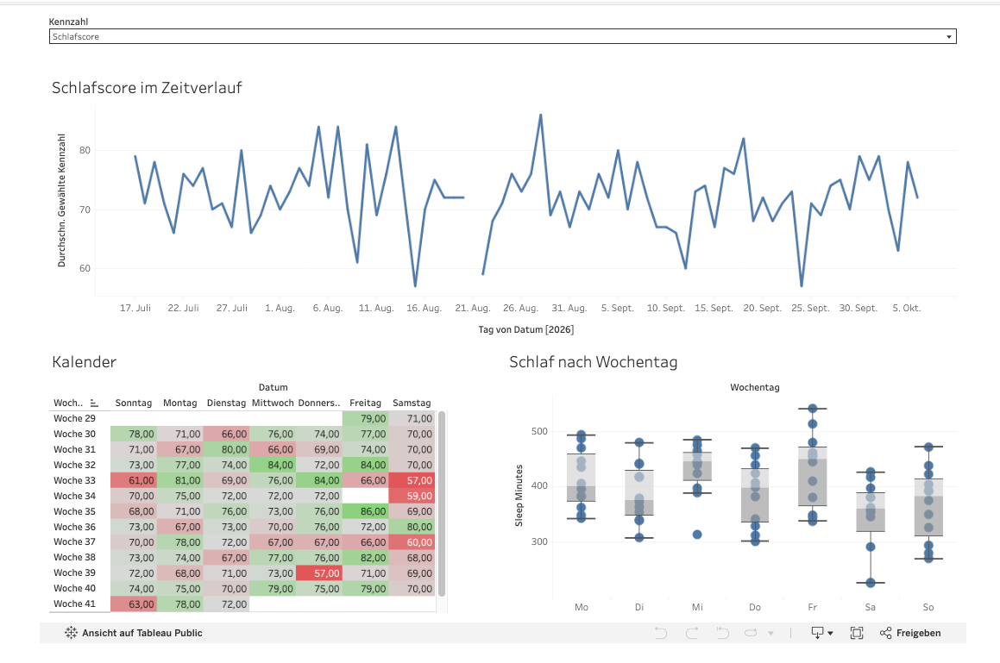

# Fitness Tracker Analyse – Tableau Dashboard

Interaktives Tableau-Dashboard zu Schlaf, Ruhepuls und Aktivität über 82 Tage (17.07.–06.10.2026).

**[Dashboard auf Tableau Public ansehen](LINK-EINFÜGEN)**



## Worum es geht

Ich wollte herausfinden, was meine Schlafqualität tatsächlich beeinflusst, und dabei Tableau von Grund auf lernen. Jedes Ergebnis habe ich zusätzlich in Python nachgerechnet, um zu prüfen, ob die Tableau-Berechnungen stimmen.

> **Hinweis zu den Daten:** Der Datensatz ist synthetisch. Er ist einem Fitbit-Export nachgebildet (gleiche Kennzahlen, realistische Wertebereiche und Muster), enthält aber keine echten Gesundheitsdaten.

## Datensatz

- 82 Tage, eine Zeile pro Tag
- 18 Kennzahlen: Ruhepuls, HRV, Schlafdauer, Schlafscore, Tiefschlaf, Wachzeit, Einschlaf- und Aufwachzeit, Schritte, Active Zone Minutes, Distanz, Kalorien, Readiness, VO2max u. a.
- Ergänzte Hilfsspalten: Wochentag, Kalenderwoche, Trainingstag, Nacht nach Training, Ausreißer-Kennzeichnung
- Schlafwerte stehen beim Aufwachtag (Nacht von D-1 auf D)

## Dashboard

| Ansicht | Frage |
| --- | --- |
| Kennzahl im Zeitverlauf | Wie entwickelt sich eine frei wählbare Kennzahl? (Auswahl per Parameter) |
| Kalender-Heatmap | Welche Wochen und Wochentage fallen beim Schlafscore auf? |
| Schlaf nach Wochentag | Wie verteilt sich die Schlafdauer über die Woche? |

Ein Klick auf eine Kalenderwoche filtert die anderen Ansichten.

Weitere Arbeitsblätter: Ruhepuls-Trend mit Trendlinie, geglätteter Ruhepuls mit Normalbereich, Schlafdauer vs. Schlafscore, Vortag-Effekt, Schlaf & Readiness pro Woche, Abweichung vom Wochentagsmittel.

## Verwendete Tableau-Techniken

- Berechnete Felder (IF, CASE, DATENAME)
- Tabellenberechnungen: `LOOKUP` für Vortagswerte, gleitender 7-Tage-Durchschnitt
- LOD-Ausdruck: `{FIXED [Wochentag] : AVG([Sleep Minutes])}` und Kontextfilter
- Parameter mit dynamischem Titel
- Dashboard-Filteraktionen
- Doppelachse, Referenzband, Trendlinien, Boxplots, Heatmap

## Ergebnisse

| Erkenntnis | Wert |
| --- | --- |
| Schlafdauer erklärt den größten Teil des Schlafscores | +4,4 Punkte pro Stunde Schlaf, R² = 0,64 |
| Nach Trainingstagen wird länger geschlafen | 430 vs. 380 Minuten (+50 min, p = 0,001) |
| Wochentagsmuster | Freitag bester Schlafscore (76,0), Samstag schwächster (67,8) |
| Ruhepuls steigt leicht an | ca. +0,35 bpm pro Woche (ohne einen Ausreißertag) |

**Scheinzusammenhang:** Viele Schritte am Vortag gehen mit besserem Schlaf einher (r = 0,34). Die schrittreichen Tage sind aber fast immer die Trainingstage. Ob der Effekt von den Schritten oder vom Training kommt, lässt sich mit diesen Daten nicht trennen.

## Grenzen

- Synthetische Daten, nur 82 Tage
- Korrelationen, keine Kausalaussagen
- Einzelne fehlende Werte (z. B. Schlafscore am 21.08.)

## Dateien

```
data/fitness_tableau.csv     Datensatz mit Hilfsspalten
screenshots/dashboard.png    Screenshot des Dashboards
```

## Autor

Dennis Chung · Wirtschaftsinformatik (B.Sc.) · [LinkedIn](https://www.linkedin.com/in/dennis-chung7)
